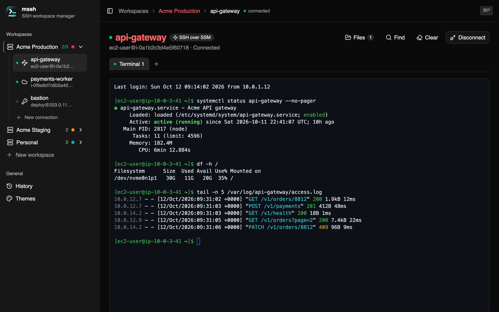
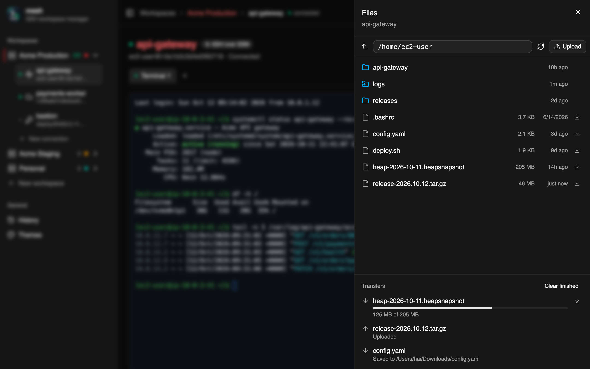
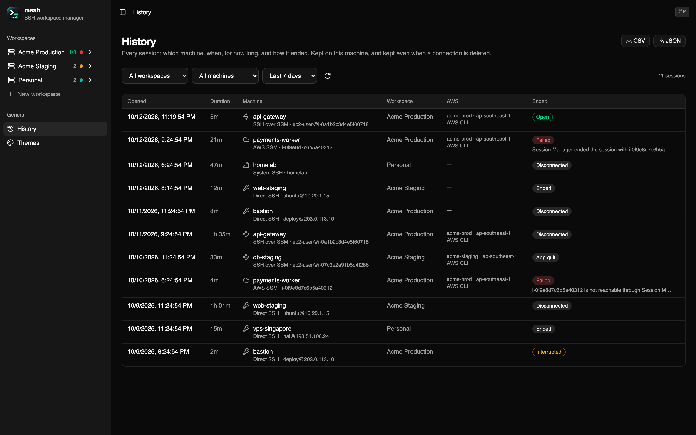

# mssh



**A desktop app for the servers you keep having to reach** — including the ones
you can't SSH into.

If you look after more than a handful of machines, the day looks like this: an
`~/.ssh/config` you half remember, a scrollback you lose every time you close a
tab, an AWS instance id pasted from a wiki, and a `start-session` command you
copy from a colleague. The machines are not the hard part. Keeping track of them
is.

mssh puts them in one window. Connections live in workspaces — one per account,
environment or customer — and each one records exactly how to reach that
machine, so you never assemble the command again. Open a session, go read
something else, come back: it is still there, still in the same directory, with
`top` still running.

It reaches machines four different ways, including AWS Session Manager, so
instances with no open port and no public IP work the same as a VPS you rent by
the month.

Nothing leaves your computer. There is no account and no sync: connections,
passwords and session history go in a local SQLite file readable by you alone.
AWS credentials stay with the AWS CLI — unless you choose to keep a key pair on a
workspace, and even then they are handed to the CLI, never sent anywhere.

Built with [Wails](https://wails.io): a Go backend and a React interface, in one
binary.

---

## Install

### Download a build

Grab the latest `mssh-<version>-macos-universal.dmg` (or `.zip`) from the
[Releases page](https://github.com/thanhhai45/mssh/releases), open it, and drag
`mssh.app` into `/Applications`. One universal build runs on Apple silicon and
Intel.

**macOS will refuse to open it the first time.** The app is not signed with an
Apple Developer certificate, so Gatekeeper blocks it:

> "mssh" cannot be opened because Apple cannot check it for malicious software.

Right-click the app, choose **Open**, and confirm — you only have to do this once.
Or clear the quarantine flag from a terminal:

```bash
xattr -dr com.apple.quarantine /Applications/mssh.app
```

### Build from source

```bash
git clone git@github.com:thanhhai45/mssh.git && cd mssh
wails build
```

The application is written to `build/bin/mssh.app`. See
[Requirements](#requirements) for what building needs.

---

## Features

- **Workspaces** — group connections by account, environment or customer, each
  with its own colour and AWS defaults.
- **AWS without the AWS CLI set up** — a workspace can keep its own key pair,
  typed in or imported from the `AWS_*` variables your shell exports. Workspaces
  that use `~/.aws` or SSO keep working exactly as before.
- **Four ways to reach a machine** — a `Host` alias from your existing
  `~/.ssh/config`, direct SSH, AWS Session Manager, or SSH tunnelled through
  Session Manager.
- **Several terminals per machine** — open tabs with `⌘T`, close them with `⌘W`.
  Switch to another connection and back: scrollback, working directory and a
  running `top` are all still there.
- **Files over the same connection** — `⌘E` opens a drawer to browse, download
  and upload over SFTP on the terminal's own SSH connection, through Session
  Manager too. Transfers show progress, can be cancelled, keep going while you
  move around the app, and never leave a half-written file under the real name.
- **Session history** — every session with its machine, workspace, AWS profile,
  duration and how it ended. Filter it, export it as CSV or JSON. The record stays
  when a machine is renamed or deleted.
- **Host keys you can trust** — the first time you reach a machine, mssh shows its
  fingerprint and asks, the way `ssh` does — even through an SSM tunnel. A key
  that has *changed* is refused, never offered.
- **Real terminal** — a full pty with `TERM=xterm-256color`, so `vim`, `htop`,
  `clear` and colours all work, and the remote shell follows the window when you
  resize it.
- **Search the scrollback** — `⌘F` finds text anywhere in the session, with every
  match highlighted and a running count.
- **Appearance you choose** — nine terminal themes (GitHub, iTerm2, VS Code,
  Dracula, Nord, Solarized, Gruvbox, Tokyo Night) or *Auto*, which follows macOS
  between light and dark; font family, size, line height and cursor style, all
  applied to live sessions without reconnecting.
- **Local SQLite database** — everything lives on your machine. No account, no
  sync, no telemetry.

### Keyboard shortcuts

| Key | Does |
| --- | --- |
| `⌘P` | Jump to any connection by name, host or workspace. |
| `⌘T` | New terminal tab for this machine. |
| `⌘W` | Close the current tab (the last one stays). |
| `⌘E` | Open or close the Files drawer. |
| `⌘F` | Find in the terminal. `⏎` next match, `⇧⏎` previous, `Esc` close. |
| `⌘K` | Clear the terminal, iTerm2 style — local only, the remote shell is not told. |

| | |
|---|---|
|  |  |

---

## Connection kinds

| | **System SSH** | **Direct SSH** | **AWS SSM** | **SSH over SSM** |
|---|---|---|---|---|
| You configure | one alias | host, user, credentials | instance id, profile, region | all of the above |
| Talks to | whatever `ssh` decides | port 22 on the host | the Session Manager API | the API, then SSH inside it |
| Needs on your machine | the `ssh` command | nothing extra | AWS CLI + Session Manager plugin | AWS CLI + plugin + an SSH key |
| Needs on the server | whatever your config implies | an open SSH port | SSM Agent and an IAM role | SSM Agent, IAM role, and `sshd` |
| You land as | whatever `~/.ssh/config` says | the user you configure | `ssm-user` | the user you configure |
| Unknown host key | `ssh` asks in the terminal | mssh asks, with the fingerprint | n/a | mssh asks, with the fingerprint |
| Files drawer (SFTP) | yes, over `ssh`'s own connection | yes | no | yes |

**System SSH** is the one to start with if you already have an `~/.ssh/config`.
You give mssh a `Host` alias and nothing else; OpenSSH supplies the user, the
key, `ProxyCommand`, jump hosts and host-key checking, exactly as it does on the
command line. Anything you can already `ssh` into works here with no further
setup.

Its Files drawer rides on the same login. mssh starts `ssh` as a connection
master (`ControlMaster`, with a private socket and a short `ControlPersist`), and
the file client is a second `ssh -s sftp` through that socket, so there is no
second password, 2FA prompt or `ProxyCommand` tunnel. The options on the command
line outrank any `ControlMaster` settings in your config for these sessions only.
Windows' `ssh` cannot share a connection, so there the drawer is not available.

The other three exist for when you would rather describe the machine to mssh
than to a config file. **Direct SSH** for anything reachable over the network,
**AWS SSM** for EC2 instances with no open port and no public IP, and **SSH over
SSM** when you want that tunnel *and* your own account rather than `ssm-user`.

---

## Requirements

### Always

- **macOS** — developed, tested and released here. Windows and Linux installers
  are planned; the app compiles for both, but neither is tested yet.

Nothing else. Direct SSH connections work out of the box — the SSH client is
compiled into the binary.

### Only for the AWS SSM kinds

```bash
brew install awscli
brew install --cask session-manager-plugin
```

The app checks for both before it tries to connect, and tells you which one is
missing rather than failing silently. It also reports an expired SSO session and
prints the `aws sso login` command you need.

By default your AWS credentials stay entirely with the AWS CLI, and mssh only
passes it a profile and region name. A workspace can instead keep its own key
pair — see [Security](#security).

### Only to build from source

- Go 1.26 or newer
- Node.js 20 or newer
- The Wails CLI:

```bash
go install github.com/wailsapp/wails/v2/cmd/wails@latest
```

---

## First run

The database is created automatically the first time the app starts:

| Platform | Location |
|---|---|
| macOS | `~/Library/Application Support/mssh/mssh.db` |
| Linux | `~/.config/mssh/mssh.db` |

To back up your connections, copy that file. To start over, delete it — a fresh
one is created on the next launch.

The database schema is versioned and upgraded in place, so your data survives
app updates.

---

## Connecting to a server for the first time

mssh verifies every server's host key against `~/.ssh/known_hosts` — the same
file the `ssh` command uses. The first time you reach a machine there is nothing
to check its key against, so mssh shows you the key and asks, the way `ssh`
does:

> **First connection to 203.0.113.10**
> ssh-ed25519 `SHA256:AbCd…`

If you can, compare it with the server's own before trusting it. On the server,
this prints it:

```bash
ssh-keygen -lf /etc/ssh/ssh_host_ed25519_key.pub
```

For an EC2 instance, open it once with the **AWS SSM** kind and run that there.
For **SSH over SSM** the name shown is the instance id, so the fingerprint is the
only thing you have to go on — it is worth checking.

Then choose **Trust and connect**. The key is written to `~/.ssh/known_hosts`
and you will not be asked again.

The **System SSH** kind never shows this dialog: there, `ssh` asks in the
terminal, as it always does.

### 🚨 If the key has *changed*

A different message means something else entirely:

```
the host key for 203.0.113.10 has CHANGED since it was recorded
```

mssh never offers to trust a changed key. It means one of two things:

1. The server was rebuilt or reinstalled — normal, but confirm it with whoever
   runs the machine before continuing.
2. Something is intercepting your connection. Everything you type, including
   passwords, would go to them first.

Only once you are certain it is case 1:

```bash
ssh-keygen -R 203.0.113.10
```

then connect again and accept the new fingerprint.

---

## Security

- **Credentials stay on this machine.** SSH passwords and any AWS keys a
  workspace keeps are stored in the local database, in tables of their own that
  never travel to the UI with the rest of a connection, and are never sent
  anywhere. The database is readable by you alone — `0600` in a `0700`
  directory, the same protection the AWS CLI gives `~/.aws/credentials`:

  ```bash
  ls -la ~/Library/Application\ Support/mssh/
  ```

- **Deleting a connection deletes its password**, and deleting a workspace
  deletes its AWS keys and every password inside it. The database does this
  itself, through foreign keys.
- **Host keys are always verified.** A new machine is a question with its
  fingerprint; a changed key is refused. There is no "connect anyway" option, by
  design.
- **The session history never holds a secret.** It records which machine, when,
  for how long, and where the credentials came from — never a password or a key.
- **AWS uses the CLI's own configuration by default.** SSO refresh, MFA and
  assume-role are all done by the AWS CLI in a separate process. A workspace set
  to use stored keys hands them to `aws` through its environment, never its
  command line, where every user on the machine could see them with `ps`.
- **Only `PATH` is taken from your shell**, so mssh can find `aws` and `ssh`
  when opened from Finder. *Import from shell* reads the six `AWS_*` variables
  it needs, when you press it, and nothing else.
- **Passphrase-protected SSH keys are not read directly.** Load those into
  `ssh-agent` with `ssh-add` and choose the agent authentication method.

---

## Development

```bash
wails dev
```

This starts the app with hot reload for the frontend. It also serves the app at
<http://localhost:34115>, where you can open browser devtools and call the Go
methods directly as `window.go.main.App.*`.

Note that <http://localhost:5173> is the raw Vite server — the Go bridge is not
injected there, so `window.go` will be undefined.

### Tests and checks

```bash
go test ./internal/...   # store, secrets, session, transport and files
go vet ./internal/...
gofmt -l .
```

> `./internal/...` rather than `./...`: package `main` embeds `frontend/dist`,
> which does not exist until `wails build` has run.

`errcheck` finds ignored errors, which the compiler does not:

```bash
go install github.com/kisielk/errcheck@latest
errcheck -exclude .errcheck-excludes ./internal/...
```

Ignoring an error is allowed, but it has to be written down — `_ = f()` — so
that it reads as a decision rather than an oversight. `.errcheck-excludes` lists
the handful of `database/sql` methods whose error is meaningless by contract,
with the reason next to each.

Frontend:

```bash
cd frontend
npm run typecheck   # tsc --noEmit
npm run lint        # eslint
npm run build       # tsc, then vite build
```

ESLint is here mainly for `react-hooks/exhaustive-deps` and
`react-hooks/set-state-in-effect`, which catch the class of bug TypeScript
cannot see: a hook reading a value it never declared, and so quietly using a
stale one. The `react-refresh/only-export-components` warnings are expected —
several modules deliberately export a hook next to its provider.

All of this runs on every push through `.github/workflows/check.yml`.

### Regenerating the frontend bindings

After changing any method on `App`:

```bash
wails generate module
```

---

## Project layout

```
main.go                  wiring: open the database, start Wails
app.go                   the bridge to the frontend; thin by design

internal/store/          SQLite: workspaces, connections, secrets, settings, session log
    migrations/          numbered .sql files, applied in order
internal/secrets/        the password vault contract, and the one-time move off the Keychain
internal/transport/      one Dialer per connection kind; SFTP on SSH sessions
internal/session/        live sessions, kept alive independently of the UI
internal/files/          directory listing and file transfers over SFTP

frontend/src/
    lib/api.ts                 the only module that imports the Wails bindings
    lib/terminal-session.ts    terminals, deliberately outside React
    components/                dialogs, sidebar, terminal view
    routes/                    pages
```

---

## Troubleshooting

| Message | What to do |
|---|---|
| `... has never been connected to from this machine` | Check the fingerprint and choose *Trust and connect* — see the section above |
| `the host key ... has CHANGED` | Stop and verify with the server's owner |
| `refused the connection before the SSH handshake started` | sshd's `MaxStartups` turned you away because its queue of unauthenticated logins was full — on a public server that queue is mostly bots. mssh retries three times on its own; if it still fails, raise `MaxStartups` in `/etc/ssh/sshd_config` or put fail2ban in front of the port |
| `refused the credentials` | Check the username character for character, and whether the server allows password logins at all |
| `ssh-agent is not running` | Start it, or switch the connection to a key file or password |
| `key ... is protected by a passphrase` | `ssh-add <key>`, then use the SSH agent method |
| `the Session Manager plugin is not installed` | `brew install --cask session-manager-plugin` |
| `your AWS session has expired` | Run the `aws sso login` command in the message |
| `no AWS credentials this app can see` | mssh does not take AWS keys from your shell environment. Either configure the AWS CLI (`aws sso login` or `aws configure`) and set the profile on the workspace, or edit the workspace, choose *Use keys stored in mssh* and press *Import from shell* |
| `set to use AWS keys stored in mssh, but none are saved` | Edit the workspace and add the keys, or switch it back to the AWS CLI's configuration |
| `the temporary AWS keys stored on this workspace have expired` | Temporary keys carry a session token that runs out. Import or paste fresh ones in the workspace settings |
| `... is not reachable through Session Manager` | Check the instance is running, has the SSM Agent, and has an IAM role with `AmazonSSMManagedInstanceCore` |
| `this AWS profile is not allowed to run ssm:StartSession` | Add that permission to the role or user |
| `connection ... is already open` | The session is still running; disconnect it first |
| `this connection runs a program rather than holding an SSH connection, so it cannot browse files` | The Files drawer needs System SSH, Direct SSH or SSH over SSM. AWS SSM connections (and System SSH on Windows) run a program instead |
